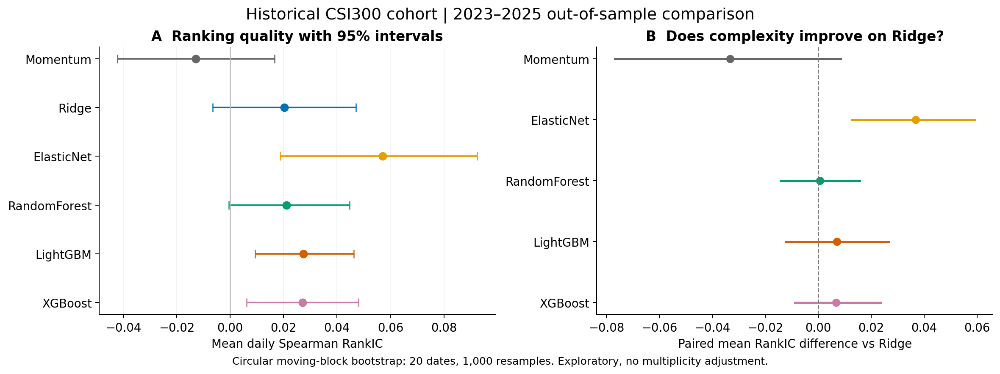

# AshareRank Research

AshareRank Research is a reproducible research codebase for studying cross-sectional stock ranking in the China A-share market. Its current working question is whether sequence and cross-sectional models improve out-of-sample ranking of five-day excess returns over simpler baselines, and whether any improvement survives portfolio costs.

This project is a product of the **NUS SOC Summer Workshop 2026**.

The repository is organized around data lineage, controlled experiments, out-of-sample evaluation, and reproducible reports. It is not a trading product and does not place orders.

## Project website

[Visit the public website](https://asharerank-research.cryptic3036.chatgpt.site) · [中文](https://asharerank-research.cryptic3036.chatgpt.site/?lang=zh) · [English](https://asharerank-research.cryptic3036.chatgpt.site/?lang=en)

The Chinese/English project presentation lives in [`website/`](website/README.md). It describes the research question, methods, model comparison and remaining limitations. It is separate from the Python research workflow and contains no live predictions or unverified performance results.

## Research workflow

The first completed study compares Ridge, Elastic Net, Random Forest, LightGBM and XGBoost, plus momentum, on 60 stocks selected from the **2018 historical CSI300 universe**. It uses 130,505 real BaoStock daily rows and tests 2023–2025 with purged expanding training windows. StockMixer is deferred.

- [中文报告与图表](reports/baselines/20260928T065633Z_simple_baselines/README.md) · [English report](reports/baselines/20260928T065633Z_simple_baselines/README.en.md)
- [Frozen protocol](docs/baseline_protocol.md) · [Configuration](configs/public_baselines.json) · [Aggregate metrics and provenance](reports/baselines/20260928T065633Z_simple_baselines/summary.json)



Elastic Net has the largest observed mean RankIC (0.0571), but results depend on period, costs and rebalance timing. Portfolio figures are execution proxies with explicit suspension, price-screen and delisting limitations, not verified tradable returns.

```powershell
python -m pip install -e ".[research]"
python scripts/research/run_public_baselines.py --config configs/public_baselines.json
```

Raw data, fitted models and predictions stay in ignored `data/` and `runs/`. Only curated findings and reproducibility metadata are committed.

```text
provider data → validated market panel → point-in-time features and labels
              → purged chronological splits → model runs
              → predictive and portfolio metrics → reports
```

Research code lives in `src/asharerank/`; command-line workflows live in `scripts/research/`; automated checks live in `tests/research/`. Downloaded data, trained weights, and experiment outputs are local artifacts and are not committed.

## Setup

Use Python 3.11 or newer. In PowerShell:

```powershell
py -3.11 -m venv .venv
.\.venv\Scripts\Activate.ps1
python -m pip install --upgrade pip
python -m pip install -e ".[data,tree,deep,dev]"
```

Optional market-data credentials can be placed in a root `.env` file based on `.env.example`. If no live provider is available, the data layer can fall back to local cache or synthetic data; synthetic rows must be identified in any reported result.

## Main commands

```powershell
asharerank fetch-universe --help
asharerank build-dataset --help
asharerank benchmark --help
asharerank list-experiments
```

For a small development run, limit the number of stocks and epochs. A full benchmark can take considerable time and requires the corresponding optional model dependencies and historical data. Record the exact command and configuration with the resulting run.

## Data and artifacts

| Path | Contents | Git policy |
|---|---|---|
| `data/raw/` | Source downloads and immutable snapshots | ignored |
| `data/processed/` | Validated panels, universes, and derived datasets | ignored |
| `data/cache/` | Provider and intermediate caches | ignored |
| `runs/` | Model weights, predictions, logs, metrics, and reports | ignored |
| `reports/` | Curated research write-up and selected figures | tracked |

Every result intended for a conclusion should state the data source and date range, universe, label horizon, split boundaries, model configuration, random seeds, transaction-cost assumptions, and code revision. Do not infer a future return from a percentile-mapped display score.

## Evaluation

Predictive metrics include IC, RankIC, ICIR/RankICIR, and Precision@K. Portfolio metrics include net return, Sharpe, maximum drawdown, and turnover under explicit transaction-cost assumptions. Compare models on the same dates and the intersection of covered `(date, ticker)` samples. Use validation data for model selection and reserve test data for final evaluation.

Forward labels overlap in time. Any split used for inference must purge at least the label horizon around train/validation/test boundaries; record the excluded dates. Results from an unpurged split are exploratory and must not be presented as final out-of-sample evidence.

## Project guidance

- [`AGENTS.md`](AGENTS.md): repository rules for future coding agents and collaborators.
- [`RESEARCH_PLAN.md`](RESEARCH_PLAN.md): research question, protocol, known risks, and status tracker.
- [`docs/architecture.md`](docs/architecture.md): code and data flow.
- [`docs/research_protocol.md`](docs/research_protocol.md): experiment and reporting standards.

The old application UI, game, and API shell have been moved to `.legacy-archive/` on this local checkout and are excluded from the active project. They are not part of the research workflow.
