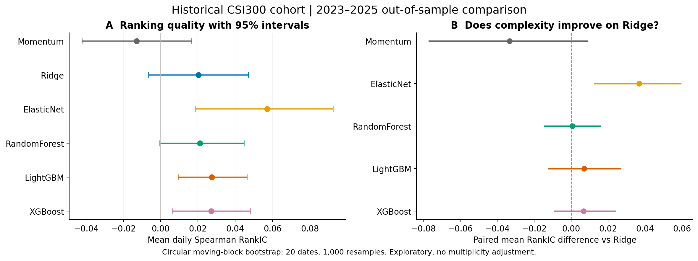
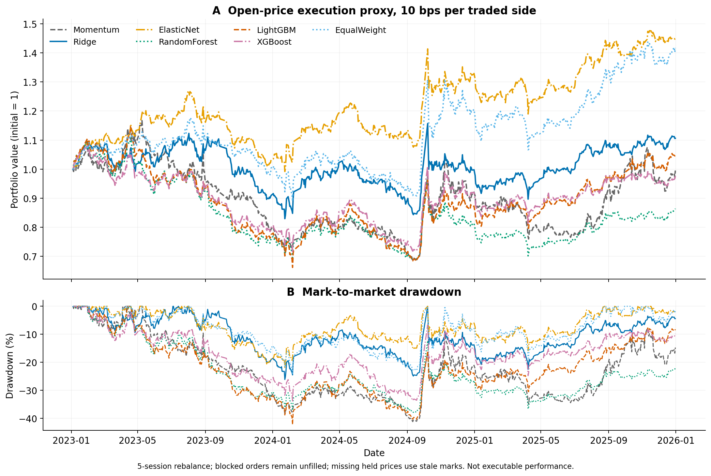
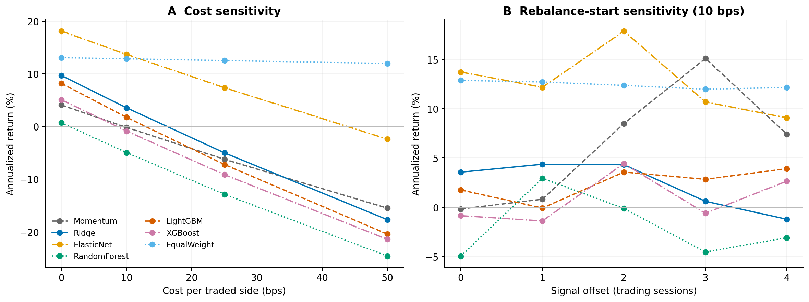
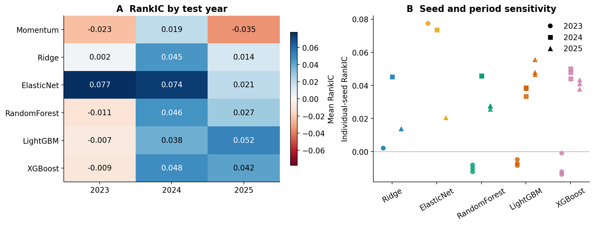

# Simple-model comparison: historical A-share cohort

Run ID: `20260928T065633Z_simple_baselines`  
Source revision: `4a501c1da1f5ea38769fcb3ae20260cb695bc271` (dirty=False)  
Reproduce: `python scripts/research/run_public_baselines.py --config configs/public_baselines.json`

## Findings

The highest observed mean RankIC is **ElasticNet** (0.0571). Models with a positive unadjusted paired 95% interval versus Ridge: **ElasticNet**. This is an exploratory comparison, not proof of general superiority or profitable deployability.

The run contains 130,505 real source rows from 60 fixed historical constituents. The common predictive sample has 41,456 observations over 709 dates, with 55–60 eligible stocks per date. 342 prediction rows lack forward outcomes. Portfolio selection retains the signal-time universe independently of label availability.

## Predictive comparison

| Model | RankIC | 95% block CI | IC | RankICIR | Precision@10 |
|---|---|---|---|---|---|
| Momentum | -0.0129 | [-0.0423, 0.0166] | -0.0026 | -0.057 | 44.8% |
| Ridge | 0.0203 | [-0.0065, 0.0471] | 0.0045 | 0.096 | 46.7% |
| ElasticNet | 0.0571 | [0.0186, 0.0925] | 0.0281 | 0.227 | 48.0% |
| RandomForest | 0.0210 | [-0.0005, 0.0448] | 0.0098 | 0.114 | 44.7% |
| LightGBM | 0.0274 | [0.0094, 0.0463] | 0.0188 | 0.169 | 45.1% |
| XGBoost | 0.0271 | [0.0062, 0.0480] | 0.0144 | 0.153 | 46.1% |

RankIC is daily Spearman correlation with five-session cohort-excess returns. RankICIR is the daily mean divided by daily sample standard deviation, not annualized. Precision@10 is the proportion of selected stocks with positive cohort-excess return; the observed baseline positive rate is 45.7%.

## Portfolio proxy after costs

| Model | CAGR | Sharpe | Max drawdown | Annual 2-way turnover | Blocked orders | Stale position-days |
|---|---|---|---|---|---|---|
| Momentum | -0.2% | 0.13 | -41.2% | 41.6x | 3 | 0 |
| Ridge | 3.6% | 0.27 | -26.1% | 57.5x | 0 | 0 |
| ElasticNet | 13.7% | 0.82 | -21.9% | 38.1x | 3 | 0 |
| RandomForest | -4.9% | -0.14 | -37.8% | 57.9x | 0 | 0 |
| LightGBM | 1.8% | 0.19 | -42.2% | 61.5x | 3 | 0 |
| XGBoost | -0.9% | 0.07 | -33.8% | 58.1x | 1 | 0 |
| EqualWeight | 12.9% | 0.67 | -24.4% | 1.9x | 99 | 355 |

Top 10 equal weights, five-session rebalancing, next-open execution, 10 bps per traded side. EqualWeight uses all signal-eligible cohort stocks under the same execution and cost conventions. It is a cohort control, not the published CSI300 index. Sharpe and drawdown use daily open-price marks, including the initial capital of 1.

## Stability

| Model | 2023 | 2024 | 2025 |
|---|---|---|---|
| Momentum | -0.0233 | 0.0195 | -0.0348 |
| Ridge | 0.0022 | 0.0451 | 0.0138 |
| ElasticNet | 0.0775 | 0.0735 | 0.0205 |
| RandomForest | -0.0106 | 0.0464 | 0.0273 |
| LightGBM | -0.0070 | 0.0376 | 0.0516 |
| XGBoost | -0.0089 | 0.0483 | 0.0417 |

## Protocol and limitations

1. Fixed 60-stock historical CSI300 cohort, not all A-shares or a dynamically reconstituted index; a single cohort size and five-day horizon were studied.

2. Constituents were requested as of 2018-01-02; provider update dates and all selected codes are preserved. Historical vendor corrections remain possible.

3. The same training-only median imputer and scaler workflow is fitted separately per model/fold. Daily feature ranks use only signal-date eligible stocks.

4. Forward returns are next-session adjusted open to the adjusted open five sessions later. Excess returns subtract the equally weighted observed eligible-cohort return; this is not CSI300 index excess return.

5. Final six signal dates per annual fold can lose forward-label coverage; these observations are excluded from predictive metrics, never from portfolio candidate selection on the basis of future returns.

6. Backtests are an OHLC execution proxy. The conservative 9.5% open-gap screen is not an exact historical exchange price-limit model (including ChiNext changes). No order book, impact, participation cap, or lot-size model is included.

7. Suspended or screened orders remain unfilled. Missing held prices are forward-filled for valuation only. Delisting/merger terminal proceeds are unknown: stale position-days and remaining invested terminal weight must be inspected; proxy returns may be biased.

8. One cost scenario includes all friction as a constant per traded side; actual commissions, sell-side stamp tax, and spread vary over time. Sharpe uses zero risk-free rate and 252 sessions/year.

9. Intervals use 20-date circular moving blocks and 1,000 resamples; paired comparisons are unadjusted exploratory intervals, not multiplicity-controlled hypothesis tests.

10. Tree model headlines average three predetermined seeds; linear models are deterministic. Hyperparameters are chosen on the preceding validation year only. Prior test years become historical training/validation data in later folds.

11. StockMixer and LSTM were deliberately excluded. No automated test suite was run because project instructions require an explicit testing request.

## Data and reproducibility

Curated configuration, checksums, exclusions, coverage and aggregate metrics are in [summary.json](summary.json). Local raw snapshots, model weights and per-observation predictions remain in ignored `data/` and `runs/20260928T065633Z_simple_baselines/`. Use the archived snapshot to reproduce exact values; re-downloading vendor data may yield revisions.

## Sources

- [BaoStock data provider](https://www.baostock.com/)
- [BaoStock adjustment-factor methodology](https://www.baostock.com/helpdocs/pdf/BaoStock%E5%A4%8D%E6%9D%83%E5%9B%A0%E5%AD%90%E7%AE%80%E4%BB%8B.pdf)
- [AKShare alternative source documentation](https://github.com/akfamily/akshare/blob/main/docs/data/stock/stock.md) — explored, not used in this run.
