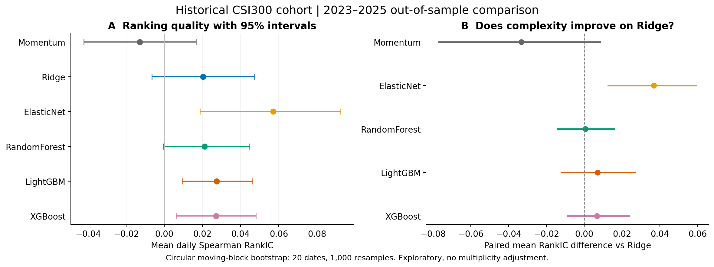
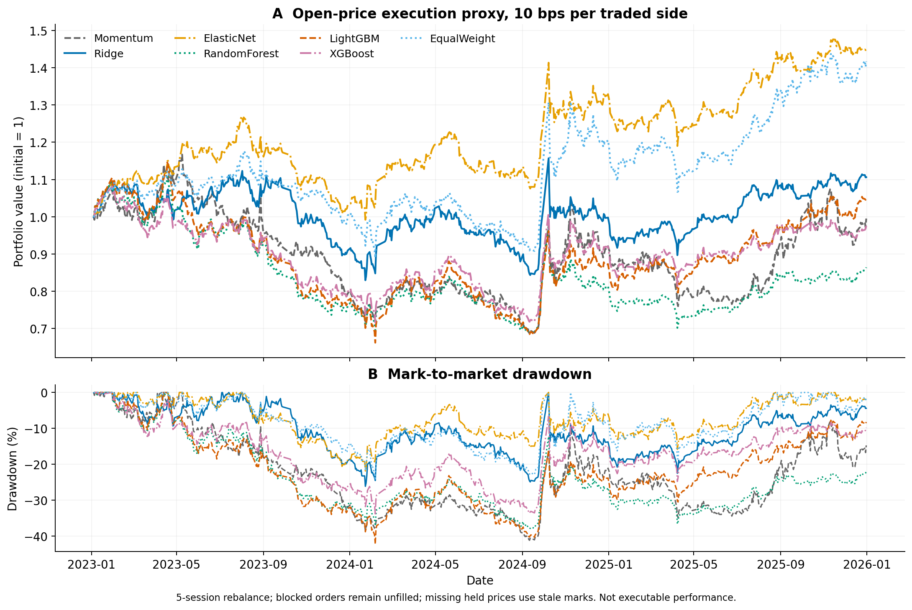
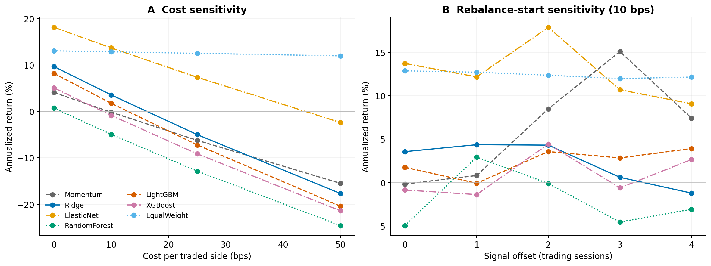
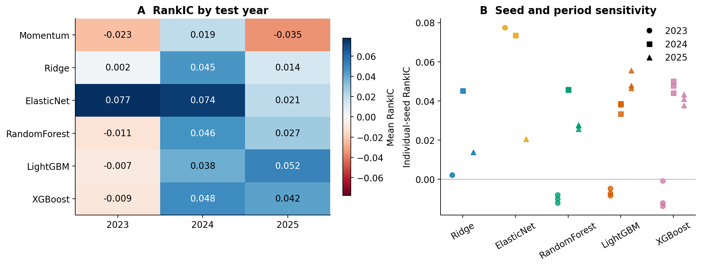

# 简单模型比较：A 股历史股票池

Run ID: `20260928T065633Z_simple_baselines`  
Source revision: `4a501c1da1f5ea38769fcb3ae20260cb695bc271` (dirty=False)  
Reproduce: `python scripts/research/run_public_baselines.py --config configs/public_baselines.json`

## 主要发现

本次样本外平均 RankIC 最高的是 **ElasticNet**（0.0571）。与 Ridge 的配对差值之未经多重比较校正的 95% 区间完全高于零的模型：**ElasticNet**。这是探索性结果，不能据此断言模型普遍更优或策略可以实盘盈利。

实际获取 **130,505 行真实行情**，股票池为 2018 年初沪深 300 成分股中预先按 SHA256 顺序选出的 **60 只**，不根据未来表现替换股票。共同评价样本为 **41,456 条、709 个交易日**，每天覆盖 55–60 只股票。缺少未来收益的预测记录为 342 条；组合选股不以未来标签是否可用来筛选候选。

## 排序指标与不确定性

| Model | RankIC | 95% block CI | IC | RankICIR | Precision@10 |
|---|---|---|---|---|---|
| Momentum | -0.0129 | [-0.0423, 0.0166] | -0.0026 | -0.057 | 44.8% |
| Ridge | 0.0203 | [-0.0065, 0.0471] | 0.0045 | 0.096 | 46.7% |
| ElasticNet | 0.0571 | [0.0186, 0.0925] | 0.0281 | 0.227 | 48.0% |
| RandomForest | 0.0210 | [-0.0005, 0.0448] | 0.0098 | 0.114 | 44.7% |
| LightGBM | 0.0274 | [0.0094, 0.0463] | 0.0188 | 0.169 | 45.1% |
| XGBoost | 0.0271 | [0.0062, 0.0480] | 0.0144 | 0.153 | 46.1% |

左图为平均 RankIC 和区块重采样区间，右图为相对 Ridge 的同日配对差值。区间跨越零时，当前数据不足以明确区分。RankIC 是逐日 Spearman 秩相关；RankICIR 为逐日均值除以样本标准差，不年化。Precision@10 为前十名中未来股票池超额收益为正的比例，其全体样本正收益基准比例为 45.7%。

## 扣除成本后的组合代理评价

| Model | CAGR | Sharpe | Max drawdown | Annual 2-way turnover | Blocked orders | Stale position-days |
|---|---|---|---|---|---|---|
| Momentum | -0.2% | 0.13 | -41.2% | 41.6x | 3 | 0 |
| Ridge | 3.6% | 0.27 | -26.1% | 57.5x | 0 | 0 |
| ElasticNet | 13.7% | 0.82 | -21.9% | 38.1x | 3 | 0 |
| RandomForest | -4.9% | -0.14 | -37.8% | 57.9x | 0 | 0 |
| LightGBM | 1.8% | 0.19 | -42.2% | 61.5x | 3 | 0 |
| XGBoost | -0.9% | 0.07 | -33.8% | 58.1x | 1 | 0 |
| EqualWeight | 12.9% | 0.67 | -24.4% | 1.9x | 99 | 355 |

采用 Top 10 等权、每五个交易日再平衡、信号后下一交易日开盘执行，表中成本为每成交方向 10 bps。基准 EqualWeight 持有当时所有符合条件的股票，使用相同执行和费用规则，不是官方沪深 300 指数。年化收益为 CAGR；夏普使用日收益、零无风险利率和每年 252 个交易日；换手按买入与卖出金额之和计算。

停牌或开盘涨跌幅超过保守阈值的订单不成交。**这仍是基于日线的成交代理，不是可实盘复制的收益**。尤其需检查表中的 Stale position-days（缺失持仓价格而沿用旧估值的天数）以及 summary.json 中的期末未变现仓位；退市、合并的最终现金流并未被完整识别。

## 跨年份与随机种子稳定性

| 模型 | 2023 | 2024 | 2025 |
|---|---|---|---|
| Momentum | -0.0233 | 0.0195 | -0.0348 |
| Ridge | 0.0022 | 0.0451 | 0.0138 |
| ElasticNet | 0.0775 | 0.0735 | 0.0205 |
| RandomForest | -0.0106 | 0.0464 | 0.0273 |
| LightGBM | -0.0070 | 0.0376 | 0.0516 |
| XGBoost | -0.0089 | 0.0483 | 0.0417 |

树模型主结果为预先固定的三个种子等权平均；线性模型为确定性拟合。每个模型只在上一年验证集上选择两组候选参数之一，所有预处理仅在训练集拟合。2023、2024、2025 年依次作为样本外测试，历史测试年份随后可以作为后续折的历史训练或验证资料。StockMixer 与 LSTM 本轮不运行。

## 数据口径与限制

- 采用 BaoStock 后复权日线，特征仅用信号日及以前的数据；标签为下一交易日开盘到再往后五个交易日开盘的收益，扣除当日可观测股票池等权前瞻收益。该超额收益不等同于相对官方指数的超额收益。
- 标签先构建再切分。只保留标签终点严格早于后续分区的训练/验证样本；由于延后一天执行，清除范围覆盖五日持有期加一天执行延迟。逐折实际排除日期保存在 summary.json。
- 股票池为固定历史队列，不代表全 A 股或动态指数成分；本轮只研究一个股票池规模与五日标签期限，不能宣称已完成所有稳健性检验。
- 行情来源、下载时刻、校验和与缺失信息均记录；没有使用合成数据或静默回退。历史数据仍可能被供应商修订，复权与最终退市结算没有独立审计。
- 开盘 ±9.5% 的保守拦截不是精确的历史涨跌停规则（例如创业板制度变化）。未模拟盘口、冲击、参与率上限和整手约束；真实税费、佣金与价差也会随时间变化。
- 区间来自 20 日循环移动区块、1,000 次重采样，保留一定序列相关性；未进行多重检验校正，不是预注册的确认性结论。
- 遵循仓库要求，本次没有运行自动化测试套件；新增科学转换的测试文件已提供，需明确要求后执行。

## 复现与来源

参见 [summary.json](summary.json) 中的配置、来源清单、分区和摘要。原始数据、逐样本预测与模型保留在本地忽略目录 `data/` 和 `runs/20260928T065633Z_simple_baselines/`，不上传 GitHub。精确复现须使用同一校验和的数据快照，重新下载可能得到修订版本。

- [BaoStock data provider](https://www.baostock.com/)
- [BaoStock adjustment-factor methodology](https://www.baostock.com/helpdocs/pdf/BaoStock%E5%A4%8D%E6%9D%83%E5%9B%A0%E5%AD%90%E7%AE%80%E4%BB%8B.pdf)
- [AKShare alternative source documentation](https://github.com/akfamily/akshare/blob/main/docs/data/stock/stock.md) — explored, not used in this run.

